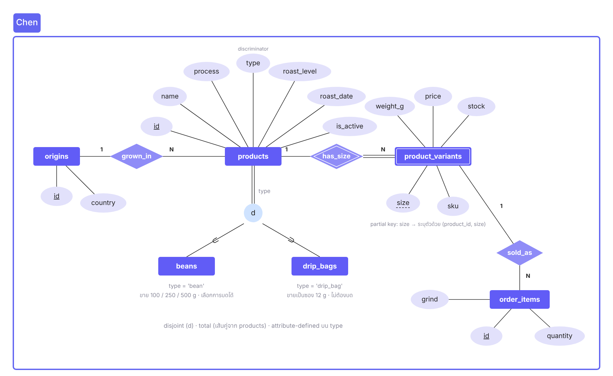
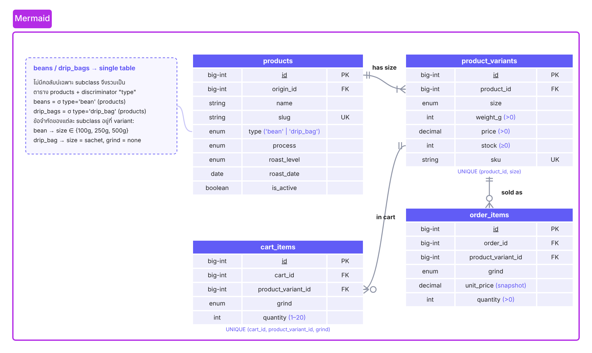

# EER: products → beans / drip_bags และการแยก product_variants

## Specialization ของ products

| หัวข้อ | ค่า |
|---|---|
| Superclass | `products` |
| Subclass | `beans` (`type = 'bean'`), `drip_bags` (`type = 'drip_bag'`) |
| Disjointness | **disjoint (d)** — สินค้าหนึ่งเป็นได้แบบเดียว |
| Completeness | **total** (เส้นคู่) — ทุกสินค้าต้องเป็น beans หรือ drip_bags |
| ชนิด | **attribute-defined** บน `type` (discriminator) |

ทั้งสองแบบมีแอตทริบิวต์ร่วมกันหมด (แหล่งปลูก, กระบวนการ, ระดับคั่ว, วันคั่ว, โน้ตรสชาติ, คะแนน cupping) ความต่างอยู่ที่ **ขนาดที่ขาย** และ **การบด**:

| subclass | ขนาดที่ขาย (`product_variants.size`) | การบด (`cart_items` / `order_items.grind`) |
|---|---|---|
| beans | 100g · 250g · 500g | เมล็ดเต็ม · บดดริป · บดเอสเปรสโซ |
| drip_bags | sachet (ซองละ 12 g) | none |

**Mapping:** ใช้แบบ *single table + discriminator* (ตาราง `products` เดียว มีคอลัมน์ `type`) เพราะ subclass ไม่มีแอตทริบิวต์เฉพาะที่ต้องเก็บ ถ้าแยกเป็นตาราง `beans` / `drip_bags` จะได้ตารางที่มีแค่ PK และทุก query หน้า Products ต้อง JOIN/UNION โดยไม่ได้อะไรเพิ่ม · ข้อจำกัดของแต่ละ subclass บังคับที่ `product_variants` (ฟอร์มแอดมินอนุญาตขนาดตาม type) และที่ตะกร้า (ดริปแบ็กบังคับ grind = none)

## ทำไมต้องแยก product_variants ออกจาก products

1. **1NF:** สินค้าหนึ่งตัวขายหลายขนาด ถ้าเก็บใน products จะกลายเป็น repeating group (`price_100g`, `price_250g`, `stock_100g`, …)
2. **2NF/3NF:** `price`, `stock`, `weight_g`, `sku` ขึ้นกับ (สินค้า, ขนาด) ไม่ได้ขึ้นกับสินค้าอย่างเดียว ส่วนชื่อ แหล่งปลูก ระดับคั่ว ขึ้นกับสินค้า → แยกตารางตาม dependency
3. **ซื้อ "ของจริง" ได้ถูกชิ้น:** `cart_items` / `order_items` อ้าง `product_variant_id` จึงรู้ว่าซื้อถุงไหน ราคาเท่าไร และตัดสต็อกถูกขนาด
4. **ตัดสต็อกพร้อมกันได้ปลอดภัย:** checkout `lockForUpdate` แถวของขนาดนั้นแถวเดียว (ถุง 250g หมด ไม่กระทบ 500g)
5. **เพิ่ม/ปิดขนาดได้โดยไม่แก้ schema:** แค่ INSERT/DELETE แถว · ขนาดที่เคยขายแล้วลบไม่ได้ (FK `restrict` จาก order_items)
6. **ทำให้ specialization ใช้งานได้:** beans มี 3 แถว variant, drip_bags มี 1 แถว (sachet) — ความต่างของ subclass อยู่ตรงนี้
7. **Weak entity โดยธรรมชาติ:** ขนาดถุงไม่มีความหมายถ้าไม่มีสินค้า ระบุตัวด้วย (product_id, size) → ใน Chen วาดเป็น weak entity + identifying relationship `has_size`, partial key = size · ตอน map ใช้ surrogate `id` + `UNIQUE (product_id, size)` เพื่อให้ cart_items / order_items อ้างอิงด้วย FK คอลัมน์เดียว

**การบดไม่ใช่ variant:** การบดไม่มีผลต่อราคาและสต็อก (ตัดสินใจไว้ใน CAPABILITY-MAP) จึงเก็บที่ `cart_items.grind` / `order_items.grind` ไม่ได้คูณจำนวนแถว variant ×3
